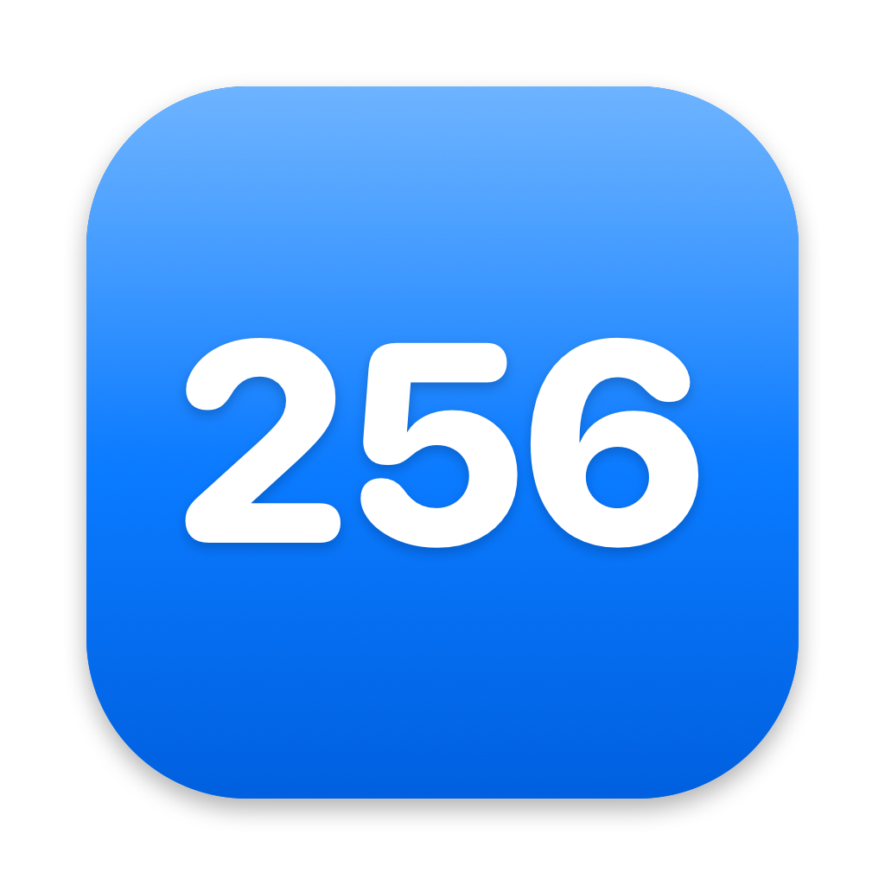

# 256isenough

**中文简介：** 把不常用的 macOS 应用打包存到 iCloud Drive、NAS 或 WebDAV，本机只留一个很小的替身（stub）。双击替身时再下载、校验、挂载并启动应用。256 GB 的 Mac 也够用。

256isenough moves Mac apps you rarely use out of `/Applications` and into a repo
you control: a folder in iCloud Drive, an SMB or NFS share, a WebDAV or OpenList
server, or any local folder. Each app is stored as a verified DMG image and is
replaced by a small signed stub with the same name and icon. When you open the
stub, 256isenough downloads the image (or uses the cached copy), checks its
SHA-256, mounts it read-only, and starts the app. Documents and URLs you open
with the stub are passed on to the app.

It comes as a menu-bar app, **256isenough.app**, with a dashboard, and as the
`isenough` command-line tool. Both use the same engine.

**用户指南 / User guide:** [`docs/user-guide.md`](docs/user-guide.md) covers
install, packing, launching, the cache, backends, several Macs, the menu-bar app,
troubleshooting, and uninstalling, in Chinese and English.

## Install

**App (recommended).** Download `256isenough-<version>.dmg` from
[Releases](https://github.com/s546126/256isenough/releases), drag 256isenough to
Applications, and open it. A drive icon appears in the menu bar; choose
**Open Dashboard**. The app is signed with a Developer ID and notarized. The CLI
is inside it at `/Applications/256isenough.app/Contents/MacOS/isenough`:

```sh
sudo ln -s /Applications/256isenough.app/Contents/MacOS/isenough /usr/local/bin/isenough
```

**Homebrew.** `brew install --cask 256isenough` installs the app and links the
CLI. `brew install isenough` installs only the CLI. Both come from the project tap;
the templates are in `packaging/homebrew/`.

**Tarball.** `isenough-<version>-macos-universal.tar.gz` holds `bin/isenough`,
`bin/isenough-stub`, and `share/isenough/web`. Keep that layout: the CLI looks
for the stub launcher beside itself and for the dashboard in `../share/isenough/web`.
Check downloads against `SHA256SUMS`.

Requires macOS 13 or later, on Apple silicon or Intel.

## First run

```sh
isenough init                       # repo in iCloud Drive by default; or: init --root /Volumes/NAS/256isenough
isenough recommend                  # big apps you have not opened in a while
isenough pack "/Applications/Some App.app"
```

`init` prints where the repo, cache, and stubs are, and the cache quota (20 GiB
by default). `recommend` ranks apps by size and time since last use, skips system
apps, running apps, and things that should stay installed (login items, menu-bar
agents, Xcode and other toolchains), and says when an app is already in the repo
from another Mac so packing it needs no upload.

`pack` builds the image, verifies it, uploads it, and only then replaces the app
with a stub. It prints the size, whether the image was reused or uploaded, where
the stub is, and what happened to the original. The original is deleted after the
image is confirmed; pass `--keep-original` to keep it next to the stub as
`<Name>.256orig.app`. If the cloud copy is not confirmed yet, pack keeps the
original and says why.

Mac App Store apps are packed in **restore** mode by default (`--mode restore`
selects it for any app): the app is copied back for the session and returned to
the repo after you quit it. Everything else uses **mount** mode and runs straight
from the read-only image.

## Everyday use

- Open the stub from Finder, Launchpad, Spotlight, or the Dock as usual.
  Or run `isenough launch "Some App"` (`--doc FILE`, `--url URL`, `--no-wait`);
  `isenough restore "Some App"` forces restore mode for one launch.
- `isenough list` shows packed apps; `isenough status` shows the cache and the state of each app.
- `isenough pin APP` keeps an app's image in the cache; `unpin` lets the cache drop it.
- `isenough prefetch APP` downloads ahead of time, for example before a flight.
- `isenough evict APP` drops the cached image; the repo copy stays.
  `isenough evict-local` removes local iCloud copies of repo files that finished uploading.
- `isenough gc` tidies up: finishes interrupted launches, moves unreferenced images to
  the repo's trash (kept 7 days), and trims the cache to its quota. `gc --dry-run` shows
  what it would do.
- `isenough doctor` checks the setup and prints each check as it finishes.

A mistyped app name gets suggestions (`Did you mean: ...`). Add `--json` to any
command for machine-readable output.

## The dashboard

The menu-bar app opens the dashboard in its own window. From a terminal,
`isenough ui --open` serves the same page and opens it in your browser
(`isenough ui --json` prints `url`, `port`, and `token` for scripts). The page
shows the backend, cache use against the quota, packed apps with icons and sizes,
pins, other Macs that share the repo, and the recommend list. From each app row you
can open, prefetch, pin or unpin, evict, and unpack; packing a new app is
`isenough pack`. The page is bilingual (Chinese and English) and follows the
system light or dark appearance. It listens only on `127.0.0.1` and needs the
random token in the URL.

The menu-bar item has **Open Dashboard**, **Copy Dashboard URL**, the version, and
**Quit**. The app has no Dock icon; reopening it shows the dashboard window again.

## Bring apps back, or uninstall

- `isenough unpack APP` puts the real app back in place of its stub after checking
  its tree hash and code signature. `unpack APP --to ~/Desktop` copies it out and
  leaves the stub.
- To remove 256isenough completely:
  1. Run `isenough list` and `isenough unpack APP` for every app you want back.
  2. If you used `isenough sessions --apply`, run `isenough sessions restore ID`
     for every archived transcript you want back (`sessions search` finds them).
     Keep the Keychain session key until this is done if you used `--encrypt`.
  3. Quit 256isenough from the menu bar and move it to the Trash (or `brew uninstall --cask 256isenough`).
  4. Delete `~/Library/Application Support/256isenough/` and `~/Library/Caches/256isenough/`.
  5. Delete the repo folder only after steps 1 and 2, and only if no other Mac uses it.

**Deleting the repo is permanent.** After `pack` the repo image is the only copy of
the app, and `sessions --apply` deletes the local transcripts it archives. Apps you
did not unpack and sessions you did not restore are gone with the repo.

Stubs for apps you did not unpack stop working once step 4 removes the engine copy
they run (`~/Library/Application Support/256isenough/bin/isenough`).

## Several Macs, one repo

Point every Mac at the same repo (`isenough init --root ...`, or the default iCloud
Drive folder). Images are write-once and keyed by bundle id, version, build,
architectures, and a content hash, so the same app on two Macs is stored once and
the second `pack` does not upload again. Each Mac writes only its own
`devices/<id>.json`, and `gc` never deletes an image that any Mac still lists, even
a Mac that has been offline for months. `isenough devices` lists the Macs and what
they use; `devices rename NAME` sets this Mac's name, and
`devices forget DEVICEID --yes` drops a Mac you no longer use. Pins, cache, and launch state
stay on each Mac.

Repos on a share or WebDAV server: `isenough backend add smb|nfs|webdav|openlist ...`,
then `backend use ID`. Passwords are read from `--password-stdin` and kept in the
Keychain. See [`docs/backends.md`](docs/backends.md).

## Permissions

- **App Management** (System Settings > Privacy & Security > App Management): needed
  to replace or restore apps in `/Applications`. Grant it to 256isenough.app, and to
  your terminal if you use the CLI. Without it, `pack` and `unpack` fail with a
  permission error and leave the app as it was.
- **Full Disk Access**: only needed when the repo or the apps live in a protected
  location, or for `isenough sessions` on folders macOS guards.
- Apps owned by root: `pack` may leave `/Applications/.isenough-original-*.app`
  behind. `isenough cleanup-backups` verifies and removes them with one
  administrator prompt. It never asks for or stores your password itself.

## Privacy

No telemetry, analytics, or update checks. 256isenough talks only to the repo you
configure. Details are in [PRIVACY.md](PRIVACY.md).

## Safety

- Nothing is replaced until a verified image exists in the repo. A missing,
  placeholder, or mismatched image stops `pack` with exit 5 and the app stays.
- Every launch checks the image SHA-256 before mounting. A dataless iCloud file is
  never attached.
- Restore-mode launches are journaled. A crash or power loss is finished by the next
  `launch`, `gc`, or `doctor --fix`. If you changed an app while it was restored,
  `isenough resolve APP` keeps, exports, or discards those changes.
- Stubs that `pack` writes are ad-hoc signed on your Mac. They are generated per app
  and never leave the Mac, so they cannot carry the release's Developer ID.
- Try it first on an app you can reinstall.

## Mount lifecycle and repo scoping

- `isenough evict APP` refuses a pinned app (exit 9, reason `pinned`); add
  `--force` to drop its cache anyway (the pin stays). A mounted or in-use image is
  never evicted, even with `--force`.
- `isenough detach APP [--force]` detaches an app's image now instead of after the
  detach delay (120 s by default). It refuses while the app is still running.
- `isenough reap [--dry-run]` detaches images left mounted under the mount root
  after their owner died. `launch`, `gc`, and `doctor --fix` also reap.
- Each stub records the repo that packed it (`repoId` in `stub.json`), so another
  repo never claims it. `isenough stub refresh --all` stamps older stubs.

## Coding-agent sessions

`isenough sessions` (dry run by default; `--apply` to act) moves cold coding-agent
transcripts into write-once zstd segments in the repo, optionally encrypted
(`sessions key init`, `--encrypt`), and keeps a local search index
(`sessions search`, `sessions restore`). See [`docs/sessions.md`](docs/sessions.md).

## Command reference

`isenough help` prints every command grouped by task. Exit codes: 0 ok, 1 failure,
2 usage, 3 unsupported, 4 backend, 5 integrity, 6 disk image, 8 no space, 9 busy,
10 hook, 14 needs attention, 64 no command. With `--json`, errors are
`{"ok": false, "error": {"code", "message"}}`. Set `ISENOUGH_DEBUG=1` to include
Foundation error details.

Environment overrides, useful for isolated test runs: `ISENOUGH_REPO_PATH`,
`ISENOUGH_CACHE_DIR`, `ISENOUGH_STATE_DIR`, `ISENOUGH_MOUNT_ROOT`,
`ISENOUGH_STUB_DIR`, `ISENOUGH_CONFIG`, `ISENOUGH_DETACH_DELAY`,
`ISENOUGH_QUOTA_BYTES`, `ISENOUGH_MIN_FREE_BYTES`, `ISENOUGH_SIGN_IDENTITY`,
`ISENOUGH_DOCTOR_TIMEOUT`, `ISENOUGH_WEB_ROOT`, `ISENOUGH_SCAN_ROOTS` (colon-separated
folders scanned instead of `/Applications` and `~/Applications` by `recommend`
and backup cleanup).

After upgrading, run `isenough install-engine` and `isenough stub refresh --app ID`
for each packed app so existing stubs use the new engine.

## Building from source

```sh
swift build && swift test       # Swift 5.9+; on Linux install libsqlite3-dev and g++ first
scripts/build-app.sh            # universal build/256isenough.app (see gui/README.md)
scripts/make-icon.sh            # redraw Resources/AppIcon.icns (committed; build-app.sh copies it)
scripts/release-sign.sh         # sign, notarize, DMG, tarball; a dry run without ISENOUGH_SIGN_IDENTITY
bash scripts/e2e.sh             # macOS end-to-end run against fixture apps in temp folders
```

Releases are cut by pushing a `v*` tag; `.github/workflows/release.yml` builds,
tests, signs, notarizes, and drafts the GitHub Release after a manual approval.
The design is in [`docs/design.md`](docs/design.md). Changes are listed in
[CHANGELOG.md](CHANGELOG.md).

## License

MIT, see [LICENSE](LICENSE). Bundled libraries are listed in
[THIRD_PARTY_NOTICES.md](THIRD_PARTY_NOTICES.md).
